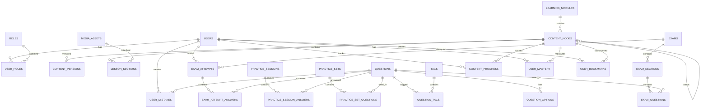

# English Learning Platform — Architecture, UX/UI, Database & API Specification

> **Version:** 2.1 (Monorepo Architecture & Vietnamese-First UX Edition)  
> **Status:** Full-Stack Implementation Ready  
> **Target Audience:** Người học tiếng Anh tại Việt Nam — Giao diện & trải nghiệm tối ưu theo tư duy và thói quen học tập của người Việt (Vietnamese-First Learning Experience).  
> **Architecture Structure:** Tách biệt rõ ràng **Frontend** (`frontend/`) và **Backend** (`backend/`) theo mô hình Monorepo chuẩn.  
> **Primary module:** Grammar & Vocabulary first, followed by Reading, Listening, Speaking, Writing, TOEIC.

---

## 0. Project Structure & How to Run (Cấu trúc phân hệ & Hướng dẫn khởi chạy)

Dự án được phân tách rõ ràng thành 2 phân hệ độc lập:

```text
D:\ENGLISH\
├── package.json              # Điều phối Monorepo toàn dự án
├── README_ENGLISH_LEARNING_PLATFORM_COMPLETE_V3.md
│
├── frontend/                 # Giao diện người dùng (Next.js 15, React 19, Tailwind CSS)
│   ├── src/
│   │   ├── app/              # App Router: các trang học tập, luyện tập, sổ tay lỗi sai
│   │   ├── components/       # Header tiếng Việt, SearchModal, ImportModal, Footer
│   │   ├── design-system/    # Bộ tokens, Card, Button, Badge, Modal, Progress
│   │   ├── features/         # Grammar Hub, Vocabulary Flashcards, Practice Runner, Dashboard
│   │   ├── lib/              # Web Speech TTS phát âm bản xứ, Client storage, Mock data
│   │   └── types/            # TypeScript Interface definitions
│   └── package.json
│
└── backend/                  # Máy chủ API & Dữ liệu (Node.js, Express, TypeScript, Prisma ORM)
    ├── prisma/
    │   └── schema.prisma     # Lược đồ CSDL quan hệ 14 bảng (PostgreSQL)
    ├── src/
    │   ├── controllers/      # Auth, Modules, Grammar, Vocabulary, Practice, Exams
    │   ├── routes/           # Định tuyến API v1 chuẩn RESTful
    │   ├── middleware/       # Response wrapper chuẩn, error handler, CORS
    │   └── server.ts         # Khởi tạo máy chủ Express cổng 5000
    └── package.json
```

### Lệnh khởi chạy tiện lợi:
Trên hệ thống Windows PowerShell (tránh bị lỗi chặn ExecutionPolicy), sử dụng `npm.cmd`:

```powershell
# Chạy Frontend trên cổng 3000 (chạy ngay từ thư mục gốc d:\ENGLISH):
npm.cmd run dev:frontend

# Chạy Backend trên cổng 5000:
npm.cmd run dev:backend

# Hoặc mở quyền PowerShell một lần duy nhất để dùng lệnh npm thông thường:
Set-ExecutionPolicy -Scope Process -ExecutionPolicy Bypass
npm run dev:frontend
```

> [!WARNING]
> **Lưu ý quan trọng trên Windows (Lỗi Casing hoa/thường):**  
> Tên thư mục vật lý là `frontend` (chữ `f` thường). Nếu dùng lệnh `cd`, hãy gõ chính xác `cd frontend` (không gõ `cd Frontend` viết hoa). Nếu gõ viết hoa, Webpack sẽ báo lỗi xung đột tên module `There are multiple modules with names that only differ in casing` và không tìm thấy `routes-manifest.json` (Lỗi 500). Cách tốt nhất là luôn chạy lệnh `npm.cmd run dev:frontend` trực tiếp từ thư mục gốc `d:\ENGLISH`.


---

## 1. Product Vision & Định hướng bản địa hóa cho người Việt

Dự án này là nền tảng học tập tiếng Anh toàn diện, được thiết kế chuyên biệt **cho người Việt học tiếng Anh**:
- **Tránh việc gì cũng dùng tiếng Anh thô cứng:** Tiêu đề, hướng dẫn làm bài, mẹo ngữ pháp, giải thích lỗi sai, phản hồi tức thì và bảng điều khiển đều được viết bằng tiếng Việt tự nhiên, gần gũi, dễ hiểu.
- **Tập trung vào các "bẫy" ngữ pháp người Việt hay mắc:** Thì hiện tại đơn quên chia "-s/-es", nhầm lẫn giữa First và Second Conditional, dùng sai giới từ do dịch word-by-word.
- **Nội dung bài học chuẩn bản xứ:** Câu hỏi, đoạn văn, từ vựng và audio phát âm US/UK chuẩn quốc tế, nhưng phần cầu nối giải thích và hướng dẫn là tiếng Việt chuẩn mực.

Grammar is the first module to be developed, but the architecture must be designed as a reusable **English Learning Platform** so that future modules can be added without rebuilding the database, authentication, progress system, question engine, analytics, or frontend foundation.

The platform should eventually support:

- Grammar
- Vocabulary
- Reading
- Listening
- Speaking
- Writing
- TOEIC
- General English
- Practice
- Mock Exams
- Personalized Review
- Learning Analytics
- Gamification
- Admin/Content Management

The core principle is:

> **Build the platform foundation once; add learning modules independently.**

---

# 2. Design Direction & Visual Identity (Phong cách thiết kế EdTech ấm áp)

## 2.1 Phong cách thiết kế thẩm mỹ EdTech ấm áp, hiện đại (Warm Aesthetic Design)

> [!IMPORTANT]
> **Định hướng sản phẩm đúng chuẩn tài liệu:**  
> Dự án là **Nền tảng học tiếng Anh toàn diện (English Learning Platform)** bám sát 100% đặc tả kiến trúc: trọng tâm cốt lõi là **Ngữ pháp (Grammar)**, **Từ vựng (Vocabulary)**, **Động cơ luyện tập đa dạng (Practice Runner)**, **Sổ tay gom lỗi sai (Mistakes Notebook)**, chuẩn bị mở rộng sang Reading, Listening, Speaking, Writing và Tổng hợp đề thi.  
> Chúng ta chỉ **kế thừa phong cách thiết kế thẩm mỹ (Design Language)** của các nền tảng EdTech hiện đại (như EyeTOEIC / Duolingo / Prep): tone màu kem ấm `#FFF8F0`, chân trang lượn sóng mềm mại, nút viên thuốc màu cam tươi năng động, thẻ pastel đa sắc và các huy hiệu bay để giao diện thân thiện, truyền cảm hứng học tập cho người Việt, **chứ không biến sản phẩm thành một trang web chỉ chuyên thi TOEIC đơn thuần**.

1. **Tone màu chủ đạo (Warm Pastel & Vibrant Accent):**
   - **Hero Background:** Tone màu kem ấm dịu mắt `#FFF8F0` kết hợp đường lượn sóng mềm mại (Curved Wave Divider) ở chân Hero, chuyển tiếp mượt mà vào nền trắng tinh tế `#FFFFFF`.
   - **Primary Action (CTA):** Nút bo tròn dạng viên thuốc (Pill Button `rounded-full`) màu cam tươi năng động `#F97316` (`bg-orange-500 hover:bg-orange-600`), tạo cảm giác thôi thúc hành động học tập mạnh mẽ nhưng không chói gắt.
   - **Thẻ Pastel đa sắc:** Sử dụng 3 gam màu pastel trang nhã (Lavender dịu `#F0F3FE`, Hổ phách ấm `#FFF8EC`, Bạc hà tươi mát `#ECFBFB`) cho các khối tính năng cốt lõi.

2. **Bố cục Hero Zone (Visual + Floating Badges):**
   - **Hình ảnh trung tâm:** Hình ảnh bạn sinh viên châu Á thân thiện, tươi tắn, đeo tai nghe và ôm sách học tập trên phông nền kem studio đồng nhất.
   - **Huy hiệu tính năng bay (Floating Feature Pills):** 5 thẻ viên thuốc bo tròn viền trắng nổi xung quanh nhân vật (`990 Thang điểm chuẩn`, `7 Parts Listening & Reading`, `Free Kho câu hỏi`, `100% Giải nghĩa tiếng Việt`, `6 tiêu chí phân tích`), tạo chiều sâu thị giác (visual depth) và kích thích tương tác.

3. **Băng thông số nổi (What the Platform Holds Right Now):**
   - Đặt trong khung bo góc lớn màu quả mơ ấm (`#FFF4EC`, viền `#FEE3CD`) với 4 chỉ số thực chiến phân tách bằng đường kẻ thanh lịch: `41,000+` Câu hỏi luyện tập, `282+` Đề thi & chuyên đề, `92,400+` File audio chuẩn bản xứ, `61,800+` Học viên tích cực.

4. **3 Giá trị cốt lõi nhận được ngay (Three Things You Get Today):**
   - 3 thẻ tính năng dạng pastel cards với icon tròn nổi bật, giải thích quyền lợi rõ ràng bằng tiếng Việt gần gũi.

## 2.2 UX Goal
The interface should feel:
- warm, welcoming and encouraging (ấm áp, thân thiện, kích thích động lực học tập)
- clean & modern (hiện đại chuẩn EdTech quốc tế)
- low cognitive load (không gây mỏi mắt khi học lâu nhiều giờ)
- content-first & Vietnamese-first (lời giải và mẹo học tiếng Việt chuẩn mực)

- consistent across modules

The intended design direction is similar in **UX philosophy** to modern English-learning platforms such as ByeTOEIC:

- clear navigation
- strong hierarchy
- prominent learning categories
- cards for content discovery
- compact progress indicators
- clear CTA buttons
- focused lesson pages
- visually separated theory/practice/test areas
- dashboard-oriented learning progress

Do **not** directly copy proprietary graphics, illustrations, text, logos, source code, or exact page designs. Use the reference as a product/UX direction and create an original design system.

## 2.2 Design Philosophy

The platform should use:

```text
Discover
   ↓
Choose a learning path
   ↓
Study
   ↓
Practice
   ↓
Test
   ↓
Review mistakes
   ↓
Track progress
   ↓
Continue learning
```

The UI should always make the next useful action obvious.

---

# 3. Global Information Architecture

The top-level product architecture should be extensible.

```text
English Learning Platform
│
├── Home
│
├── Learn
│   │
│   ├── Grammar
│   │   ├── Tenses
│   │   ├── Parts of Speech
│   │   ├── Sentence Structure
│   │   ├── Modal Verbs
│   │   └── ...
│   │
│   ├── Vocabulary
│   │   ├── Daily Life
│   │   ├── Business
│   │   ├── TOEIC
│   │   ├── Academic
│   │   └── ...
│   │
│   ├── Reading
│   ├── Listening
│   ├── Speaking
│   └── Writing
│
├── Practice
│
├── Exams
│   ├── Grammar Tests
│   ├── Vocabulary Tests
│   ├── TOEIC
│   └── Mock Exams
│
├── Review
│   ├── Mistakes
│   ├── Bookmarks
│   ├── Review Queue
│   └── Weak Areas
│
├── Progress
│
└── Account
    ├── Profile
    ├── Settings
    └── Activity
```

---

# 4. Content Hierarchy

The content system must support nested categories.

Do NOT hard-code a maximum depth such as exactly:

```text
Category → Topic → Lesson
```

Instead, support a hierarchical tree.

Example:

```text
Grammar
└── Tenses
    └── Present Tenses
        └── Present Simple
            ├── Theory
            ├── Examples
            ├── Common Mistakes
            ├── Practice
            └── Test
```

Vocabulary can use a different structure:

```text
Vocabulary
└── Business
    └── Meetings
        └── Lesson 01
            ├── Word List
            ├── Examples
            ├── Flashcards
            ├── Listening
            ├── Practice
            └── Quiz
```

Listening can use:

```text
Listening
└── Conversations
    └── Restaurant
        └── Lesson 01
            ├── Audio
            ├── Transcript
            ├── Vocabulary
            ├── Questions
            └── Review
```

Therefore:

> **The platform hierarchy is generic, while each learning module may have its own content model.**

---

# 5. Module Architecture

Each major module should be independently extensible.

## 5.1 Grammar

Initial scope:

- approximately 21 major grammar topics
- nested subtopics
- lessons
- theory
- examples
- sample exercises
- practice
- tests
- explanations
- mistakes
- mastery

Example:

```text
Grammar
├── Tenses
├── Articles
├── Pronouns
├── Prepositions
├── Adjectives
├── Adverbs
├── Modal Verbs
├── Conditionals
├── Passive Voice
├── Reported Speech
└── ...
```

## 5.2 Vocabulary

Potential features:

- topic-based vocabulary
- word details
- pronunciation
- IPA
- audio
- meanings
- examples
- synonyms
- antonyms
- collocations
- flashcards
- spaced repetition
- vocabulary quizzes
- word mastery
- saved words

## 5.3 Reading

Potential features:

- difficulty levels
- article collections
- vocabulary assistance
- reading comprehension
- questions
- explanations
- reading speed
- progress
- bookmarks

## 5.4 Listening

Potential features:

- audio player
- transcript
- speed control
- replay
- sentence-by-sentence listening
- vocabulary
- comprehension questions
- dictation
- shadowing

## 5.5 Speaking

Potential future features:

- pronunciation practice
- sentence repetition
- recording
- speech-to-text
- pronunciation scoring
- speaking prompts
- conversation practice

## 5.6 Writing

Potential future features:

- sentence writing
- paragraph writing
- guided writing
- correction
- writing prompts
- grammar feedback
- vocabulary suggestions

## 5.7 TOEIC

The TOEIC module can later contain:

```text
TOEIC
├── Part 1
├── Part 2
├── Part 3
├── Part 4
├── Part 5
├── Part 6
├── Part 7
├── Vocabulary
├── Grammar
├── Mini Tests
└── Full Mock Tests
```

---

# 6. User Roles

## Guest

Can:

- browse public content
- view selected lessons
- preview exercises
- see public information

Cannot:

- save progress
- access private analytics
- submit restricted exams
- access account-only features

## Student

Can:

- learn
- practice
- take tests
- save bookmarks
- track progress
- review mistakes
- access personalized recommendations
- manage account

## Content Editor

Can:

- create content
- edit lessons
- create questions
- manage examples
- manage media
- preview content
- submit content for publication

## Exam Manager

Can:

- create exams
- configure questions
- configure timing
- configure scoring
- publish/unpublish exams
- inspect exam statistics

## Admin

Can:

- manage users
- manage roles
- manage content
- manage permissions
- view audit logs
- manage platform configuration
- manage feature flags

---

# 7. Frontend UX Structure

Recommended frontend:

```text
Next.js
React
TypeScript
Tailwind CSS
TanStack Query
Zod
React Hook Form
```

Suggested route structure:

```text
/
├── /learn
├── /learn/grammar
├── /learn/grammar/[topic]
├── /learn/grammar/[topic]/[lesson]
│
├── /learn/vocabulary
├── /learn/vocabulary/[category]
├── /learn/vocabulary/[lesson]
│
├── /learn/reading
├── /learn/listening
├── /learn/speaking
├── /learn/writing
│
├── /practice
├── /practice/[sessionId]
│
├── /exams
├── /exams/[examId]
├── /exams/[examId]/attempt
├── /exams/[examId]/result
│
├── /review
├── /review/mistakes
├── /review/bookmarks
│
├── /dashboard
├── /profile
└── /settings
```

---

# 8. Homepage Design

The homepage should not dump every learning item onto the browser.

Recommended structure:

```text
Header
│
├── Logo
├── Learn
├── Practice
├── Exams
├── Progress
└── Account
```

Hero:

```text
Learn English
Improve your Grammar, Vocabulary,
Reading and more.

[ Start Learning ]
```

Then:

```text
Continue Learning
┌─────────────────────────────┐
│ Present Simple              │
│ ███████░░░ 70%              │
│ Continue →                  │
└─────────────────────────────┘
```

Then:

```text
Learning Areas

[ Grammar ] [ Vocabulary ]
[ Reading ] [ Listening ]
```

Then optionally:

```text
Daily Challenge
Today's practice: 10 questions

[ Start ]
```

The homepage should use lightweight summaries and load deeper data only when needed.

---

# 9. Grammar UX

## 9.1 Grammar Landing Page

Display:

```text
Grammar
Master English grammar step by step.

[ Search grammar ]

Categories
────────────────────────

Tenses
21 lessons

Articles
8 lessons

Prepositions
12 lessons
```

Each card can show:

- title
- short description
- number of lessons
- progress
- difficulty
- estimated learning time

## 9.2 Topic Page

Example:

```text
Tenses

Learn how English tenses work.

Progress: 42%

[ Continue Learning ]

Lessons
────────────────────────

01. Present Simple       ✓
02. Present Continuous   ✓
03. Present Perfect      60%
04. Past Simple          0%
...
```

Do not load every lesson body here.

Only load lesson metadata.

## 9.3 Lesson Page

Recommended learning flow:

```text
Lesson
│
├── Overview
│
├── Theory
│
├── Examples
│
├── Sample Exercises
│
├── Practice
│
└── Test
```

UI example:

```text
← Grammar / Tenses / Present Simple

Present Simple
━━━━━━━━━━━━━━━━━━━━

Theory
The Present Simple is used for...

Examples
• I work every day.
• She lives in Hanoi.

Common mistakes
...

[ Practice ]
[ Take Test ]
```

---

# 10. Lesson Content Model

A lesson should not be one giant HTML blob.

Use sections:

```text
Lesson
├── Introduction
├── Theory
├── Rules
├── Examples
├── Notes
├── Common Mistakes
├── Sample Exercises
└── Test
```

This enables:

- lazy loading
- independent editing
- analytics
- versioning
- reordering
- A/B testing later
- section-level progress

---

# 11. Practice Engine

The practice engine must be reusable across all modules.

It should support:

- multiple choice
- multiple select
- true/false
- fill in the blank
- matching
- ordering
- typing
- listening questions
- speaking questions
- image questions
- sentence correction

Question model:

```text
Question
├── prompt
├── type
├── difficulty
├── explanation
├── tags
├── media
└── options
```

The same engine can power:

```text
Grammar Practice
Vocabulary Quiz
Reading Questions
Listening Questions
TOEIC Part 5
Mock Exams
Daily Challenge
```

---

# 12. Practice Session Architecture

Never send an entire huge question bank to the browser.

Flow:

```text
POST /api/v1/practice/sessions
        ↓
Server creates session
        ↓
GET /api/v1/practice/sessions/:id/questions
        ↓
Return only required questions
        ↓
User answers
        ↓
POST /api/v1/practice/sessions/:id/answers
        ↓
Server validates
        ↓
Session result
```

For exams, correct answers should not be exposed in the initial client payload.

---

# 13. Exam System

Exam lifecycle:

```text
Draft
 ↓
Published
 ↓
Available
 ↓
Attempt Started
 ↓
Attempt Submitted
 ↓
Scored
```

Exam should support:

- time limit
- question count
- randomization
- sections
- passing threshold
- scoring rules
- attempt limits
- explanations
- review permissions

Important security rule:

> **Never trust the browser to calculate the official score.**

The server must validate and score attempts.

---

# 14. Vocabulary Architecture

Vocabulary deserves its own content model.

Example:

```text
Vocabulary Category
└── Business
    └── Meetings
        └── Lesson
            ├── Word
            │   ├── spelling
            │   ├── meaning
            │   ├── pronunciation
            │   ├── IPA
            │   ├── audio
            │   ├── examples
            │   ├── synonyms
            │   └── collocations
            │
            ├── Flashcards
            ├── Practice
            └── Quiz
```

Vocabulary mastery can use:

```text
new
learning
familiar
mastered
```

Later implement spaced repetition.

---

# 15. Reading Architecture

```text
Reading Category
└── Intermediate
    └── Article
        ├── Content
        ├── Vocabulary
        ├── Questions
        ├── Explanations
        └── Result
```

Useful metadata:

- CEFR level
- word count
- estimated reading time
- topic
- difficulty
- vocabulary level

---

# 16. Listening Architecture

```text
Listening
└── Conversation
    ├── Audio
    ├── Transcript
    ├── Vocabulary
    ├── Questions
    └── Explanation
```

Audio should be delivered through object storage/CDN, not through the application server.

---

# 17. User Progress

Progress must work across all modules.

Example:

```text
User
│
├── Grammar progress
├── Vocabulary mastery
├── Reading progress
├── Listening progress
├── Speaking progress
└── Writing progress
```

Generic progress fields:

```text
user_id
content_id
status
progress_percent
last_position
started_at
completed_at
updated_at
```

---

# 18. Mastery System

Mastery should be separate from simple completion.

Example:

```text
0%      Not Started
1-39%   Learning
40-69%  Developing
70-89%  Strong
90-100% Mastered
```

Mastery can be calculated from:

- practice accuracy
- repeated attempts
- recency
- difficulty
- mistake rate
- test results

Do not expose internal mastery formulas as fixed UI assumptions; keep the calculation configurable.

---

# 19. Mistake Review

Every incorrect answer can create or update a review record.

```text
Question
   ↓
Incorrect
   ↓
Mistake Record
   ↓
Review Queue
   ↓
Retry
   ↓
Mastery Update
```

Review screen:

```text
Your Mistakes

Grammar
Present Perfect
3 mistakes

Vocabulary
Business Meetings
5 mistakes

[ Review Now ]
```

---

# 20. Bookmark System

Users can bookmark:

- lessons
- grammar rules
- vocabulary words
- questions
- reading articles
- listening lessons

Use a generic bookmark relation where possible.

---

# 21. Search

Global search should support:

```text
Grammar
Vocabulary
Reading
Listening
Questions
Lessons
```

Search results should be categorized:

```text
Grammar
  Present Perfect

Vocabulary
  Experience

Reading
  Business Email
```

Use PostgreSQL full-text search initially.

For very large datasets, consider Elasticsearch/OpenSearch later.

---

# 22. Database Architecture

Recommended database:

```text
PostgreSQL
```

Main domains:

```text
Identity
Content
Questions
Practice
Exams
Progress
Review
Media
Analytics
Administration
```

---

# 23. Core Database Tables

## Identity

```text
users
roles
user_roles
sessions
```

## Content

```text
content_nodes
content_versions
learning_modules
lessons
lesson_sections
lesson_examples
tags
content_tags
```

## Grammar

```text
grammar_topics
grammar_lessons
grammar_rules
grammar_examples
```

Grammar-specific tables can coexist with generic content tables if the product needs structured grammar data.

## Vocabulary

```text
vocabulary_entries
vocabulary_meanings
vocabulary_examples
vocabulary_pronunciations
vocabulary_collocations
vocabulary_synonyms
```

## Questions

```text
questions
question_options
question_answers
question_explanations
question_media
question_tags
```

## Practice

```text
practice_sets
practice_set_questions
practice_sessions
practice_session_answers
```

## Exams

```text
exams
exam_sections
exam_questions
exam_attempts
exam_attempt_answers
```

## Progress

```text
lesson_progress
content_progress
user_mastery
user_learning_days
```

## Review

```text
user_mistakes
review_items
user_bookmarks
```

## Media

```text
media_assets
media_variants
```

## Gamification

```text
daily_challenges
daily_challenge_questions
achievements
user_achievements
streaks
```

## Administration

```text
audit_logs
feature_flags
```

---

# 24. Recommended Generic Content Model

A flexible hierarchy can be represented with:

```sql
content_nodes
-------------
id
parent_id
module_id
type
slug
title
description
status
order_index
metadata_json
created_at
updated_at
```

Example:

```text
Grammar
  id = 1

Tenses
  parent_id = 1

Present Tenses
  parent_id = Tenses

Present Simple
  parent_id = Present Tenses
```

This lets the product owner add new categories without database migrations for every new category.

---

# 25. Module Table

```sql
learning_modules
----------------
id
slug
name
description
icon
status
order_index
created_at
updated_at
```

Examples:

```text
grammar
vocabulary
reading
listening
speaking
writing
toeic
```

---

# 26. ERD — High Level



---

# 27. API Architecture

Base URL:

```text
/api/v1
```

Use versioning from the beginning.

---

# 28. Authentication API

```http
POST /api/v1/auth/register
POST /api/v1/auth/login
POST /api/v1/auth/logout
POST /api/v1/auth/refresh
GET  /api/v1/auth/me
```

Use secure HttpOnly cookies or short-lived access tokens with secure refresh-token handling.

---

# 29. Module API

```http
GET /api/v1/modules
GET /api/v1/modules/:slug
```

Example:

```http
GET /api/v1/modules/grammar
GET /api/v1/modules/vocabulary
```

---

# 30. Content Tree API

```http
GET /api/v1/content/:module
GET /api/v1/content/:id
GET /api/v1/content/:id/children
```

Example:

```http
GET /api/v1/content/grammar
```

returns lightweight metadata.

Then:

```http
GET /api/v1/content/:id/children
```

loads the next level.

This supports on-demand navigation.

---

# 31. Grammar API

```http
GET /api/v1/grammar/topics
GET /api/v1/grammar/topics/:slug
GET /api/v1/grammar/lessons/:id
GET /api/v1/grammar/lessons/:id/sections
GET /api/v1/grammar/lessons/:id/examples
```

Practice:

```http
POST /api/v1/grammar/practice/sessions
GET  /api/v1/grammar/practice/sessions/:id
POST /api/v1/grammar/practice/sessions/:id/answers
POST /api/v1/grammar/practice/sessions/:id/submit
```

---

# 32. Vocabulary API

```http
GET /api/v1/vocabulary/categories
GET /api/v1/vocabulary/categories/:slug
GET /api/v1/vocabulary/words/:id
GET /api/v1/vocabulary/lessons/:id
POST /api/v1/vocabulary/practice/sessions
```

---

# 33. Reading API

```http
GET /api/v1/reading/categories
GET /api/v1/reading/articles/:id
GET /api/v1/reading/articles/:id/questions
POST /api/v1/reading/practice/sessions
```

---

# 34. Listening API

```http
GET /api/v1/listening/categories
GET /api/v1/listening/lessons/:id
GET /api/v1/listening/lessons/:id/transcript
POST /api/v1/listening/practice/sessions
```

---

# 35. Generic Practice API

Eventually, most practice can converge on a reusable engine:

```http
POST /api/v1/practice/sessions
GET  /api/v1/practice/sessions/:id
POST /api/v1/practice/sessions/:id/answers
POST /api/v1/practice/sessions/:id/submit
```

Request example:

```json
{
  "sourceType": "grammar_lesson",
  "sourceId": "present-simple",
  "questionCount": 10,
  "difficulty": "mixed"
}
```

---

# 36. Exam API

```http
GET  /api/v1/exams
GET  /api/v1/exams/:id
POST /api/v1/exams/:id/attempts
GET  /api/v1/exams/:id/attempts/:attemptId
POST /api/v1/exams/:id/attempts/:attemptId/answers
POST /api/v1/exams/:id/attempts/:attemptId/submit
GET  /api/v1/exams/:id/attempts/:attemptId/result
```

---

# 37. Progress API

```http
GET /api/v1/progress
GET /api/v1/progress/:contentId
PUT /api/v1/progress/:contentId
```

Dashboard:

```http
GET /api/v1/dashboard
```

Response should be lightweight and aggregated.

---

# 38. Mistakes API

```http
GET  /api/v1/review/mistakes
GET  /api/v1/review/mistakes/:id
POST /api/v1/review/mistakes/:id/review
```

---

# 39. Bookmark API

```http
GET    /api/v1/bookmarks
POST   /api/v1/bookmarks
DELETE /api/v1/bookmarks/:id
```

---

# 40. Daily Challenge API

```http
GET  /api/v1/daily-challenge
POST /api/v1/daily-challenge/start
POST /api/v1/daily-challenge/submit
```

---

# 41. Admin API

```http
GET    /api/v1/admin/users
GET    /api/v1/admin/content
POST   /api/v1/admin/content
PUT    /api/v1/admin/content/:id
DELETE /api/v1/admin/content/:id

POST   /api/v1/admin/questions
PUT    /api/v1/admin/questions/:id

POST   /api/v1/admin/exams
PUT    /api/v1/admin/exams/:id

GET    /api/v1/admin/audit-logs
```

Admin APIs must use role-based authorization.

---

# 42. API Response Standard

Success:

```json
{
  "data": {},
  "meta": {
    "requestId": "..."
  }
}
```

List:

```json
{
  "data": [],
  "meta": {
    "page": 1,
    "limit": 20,
    "total": 100
  }
}
```

Error:

```json
{
  "error": {
    "code": "CONTENT_NOT_FOUND",
    "message": "Content not found"
  },
  "meta": {
    "requestId": "..."
  }
}
```

---

# 43. Performance Strategy

This project should be designed around:

> **Load only what the user needs.**

Do NOT:

```text
Initial page
↓
Load all grammar topics
↓
Load all lessons
↓
Load all theory
↓
Load all questions
↓
Load all images
```

Instead:

```text
Page
↓
Load summary
↓
User clicks
↓
Load next level
↓
User opens lesson
↓
Load lesson
↓
User opens practice
↓
Create session
↓
Load questions
```

---

# 44. Frontend Code Splitting

Use dynamic imports for heavy features:

```text
ExamPlayer
AudioPlayer
SpeakingRecorder
RichTextEditor
ChartLibrary
AdminEditor
```

Only load them when needed.

---

# 45. Image Optimization

Use:

- WebP/AVIF where appropriate
- responsive image sizes
- lazy loading
- CDN
- thumbnails
- blur placeholders
- width/height metadata

Example:

```html

```

Do not load full-resolution media when a thumbnail is enough.

---

# 46. Audio Optimization

For listening:

```text
Object Storage
      ↓
CDN
      ↓
Browser
```

Use:

- compressed audio
- streaming/range requests
- CDN caching
- preloading only when useful

Do not send large audio files through the application API.

---

# 47. API Caching

Use Redis for read-heavy data.

Potential cache keys:

```text
module:grammar
content:node:{id}
content:children:{id}
lesson:{id}:summary
lesson:{id}:sections
exam:{id}:metadata
daily-challenge:{date}
```

Public content can have longer TTL.

User-specific data must use carefully scoped keys.

---

# 48. CDN Strategy

Use CDN for:

```text
Images
Audio
Video
PDF
Static assets
```

Application/API traffic should remain separate.

---

# 49. Prefetching

Prefetch only likely next actions.

Example:

User is reading:

```text
Present Simple
```

The browser can prefetch:

```text
Present Simple Practice metadata
```

but should NOT download:

```text
All Grammar Questions
All Future Lessons
All Images
```

---

# 50. Pagination

Use pagination for:

- question banks
- search
- users
- admin tables
- vocabulary
- articles
- mistakes
- bookmarks

For user-facing feeds, cursor pagination can be preferred at scale.

---

# 51. Loading States

Every async area should have a meaningful loading state.

Examples:

```text
Skeleton cards
Skeleton lesson sections
Question placeholder
Audio loading indicator
Dashboard skeleton
```

Avoid blank screens.

---

# 52. Mobile-First Design

The product must be responsive.

Desktop:

```text
Header
Sidebar / content navigation
Main content
Optional right panel
```

Mobile:

```text
Header
Content
Sticky action
Bottom navigation when useful
```

Question interfaces must be touch-friendly.

Minimum target size should generally be around 44px for primary interactive controls.

---

# 53. Design System

Create reusable components:

```text
Button
IconButton
Card
Badge
ProgressBar
Tabs
Accordion
Breadcrumb
Dropdown
Modal
Drawer
Toast
Tooltip
Skeleton
Pagination
SearchBox
QuestionCard
OptionButton
AudioPlayer
LessonSection
ContentCard
StatCard
```

Learning-specific:

```text
LessonHeader
LessonProgress
TheoryBlock
ExampleBlock
ExerciseBlock
QuestionRenderer
QuestionNavigator
ExamTimer
ResultSummary
MistakeCard
MasteryIndicator
```

---

# 54. Visual Design Tokens

Use a centralized design system.

```text
Colors
Typography
Spacing
Radius
Shadow
Border
Breakpoints
Motion
```

Example conceptual tokens:

```text
--color-primary
--color-primary-hover
--color-background
--color-surface
--color-text
--color-muted
--color-success
--color-warning
--color-danger

--radius-sm
--radius-md
--radius-lg

--space-1
--space-2
--space-3
...
```

Do not hard-code colors across individual components.

This allows the entire brand to change later.

---

# 55. Navigation Design

Primary navigation should remain short.

Recommended:

```text
Learn
Practice
Exams
Progress
```

Under Learn:

```text
Grammar
Vocabulary
Reading
Listening
Speaking
Writing
```

The navigation should not become a giant tree.

Use a Mega Menu, drawer, or dedicated learning page for deeper content.

---

# 56. Dashboard

Dashboard should answer:

1. What was I learning?
2. Where did I stop?
3. What should I do next?
4. What am I weak at?
5. What have I achieved?

Example:

```text
Good morning!

Continue Learning
────────────────────────
Present Perfect
72%
[ Continue ]

Today's Goal
────────────────────────
6 / 10 questions

Your Progress
────────────────────────
Grammar       68%
Vocabulary    42%
Reading       31%

Weak Areas
────────────────────────
Present Perfect
Prepositions

[ Review Mistakes ]
```

---

# 57. Learning Analytics

Track events such as:

```text
lesson_opened
lesson_section_viewed
practice_started
question_answered
practice_completed
exam_started
exam_submitted
bookmark_created
content_completed
audio_played
audio_completed
```

Do not collect unnecessary personal data.

---

# 58. Event Tracking Architecture

Recommended:

```text
Frontend
   ↓
Analytics/Event API
   ↓
Queue
   ↓
Analytics Storage
```

High-volume events should not block the learning experience.

---

# 59. Security

Authentication:

- secure cookies
- CSRF protection where applicable
- refresh-token rotation
- password hashing with Argon2id or bcrypt
- rate limiting
- account lockout / abuse controls

Authorization:

- RBAC
- server-side permission checks
- object-level authorization

Never rely on frontend role checks for security.

---

# 60. Exam Security

For exams:

- do not send answer keys
- server-side scoring
- validate question IDs
- validate attempt ownership
- prevent unauthorized attempt access
- rate-limit answer submission
- record start/end timestamps
- handle timeout server-side
- prevent duplicate final submissions

---

# 61. Content Security

Admin content must be sanitized.

For rich text:

- sanitize HTML
- restrict embedded URLs
- restrict scripts
- validate media types
- validate uploads
- scan uploaded files where appropriate

---

# 62. File Upload Architecture

Recommended:

```text
Browser
   ↓
Request signed upload URL
   ↓
Object Storage
   ↓
CDN
```

Do not upload large files through the main API server.

---

# 63. Admin Content Workflow

Content:

```text
Draft
 ↓
Review
 ↓
Approved
 ↓
Published
 ↓
Archived
```

Every published content item should have a version.

---

# 64. Content Versioning

Recommended:

```text
content
content_versions
```

Example:

```text
Present Simple
Version 1
Version 2
Version 3
```

This enables:

- rollback
- auditing
- safe edits
- future analytics by content version

---

# 65. Database Indexes

Important indexes:

```text
users.email
content_nodes.parent_id
content_nodes.module_id
content_nodes.slug
content_nodes.status
questions.type
questions.difficulty
question_tags.tag_id
practice_sessions.user_id
practice_sessions.status
exam_attempts.user_id
exam_attempts.exam_id
content_progress.user_id
content_progress.content_id
user_mistakes.user_id
user_bookmarks.user_id
```

Add composite indexes based on real query patterns.

---

# 66. Redis

Redis can support:

```text
Caching
Rate limiting
Session data
Temporary exam state
Background job queues
Daily challenge generation
```

Recommended queue:

```text
BullMQ
```

---

# 67. Background Jobs

Examples:

```text
Generate daily challenge
Update mastery
Calculate analytics
Send notifications
Process media
Generate thumbnails
Cleanup expired sessions
Recalculate statistics
```

Never perform expensive analytics work synchronously during a normal page request.

---

# 68. Recommended Backend

Option A:

```text
NestJS
PostgreSQL
Prisma
Redis
BullMQ
S3-compatible Storage
```

Option B:

```text
Next.js
PostgreSQL
Drizzle
Redis
```

For a larger team and larger domain, NestJS provides clearer backend modularity.

---

# 69. Backend Modules

Recommended:

```text
AuthModule
UsersModule
RolesModule

ContentModule
GrammarModule
VocabularyModule
ReadingModule
ListeningModule
SpeakingModule
WritingModule
ToeicModule

QuestionModule
PracticeModule
ExamModule

ProgressModule
MasteryModule
ReviewModule
BookmarkModule

MediaModule
AnalyticsModule
NotificationModule

AdminModule
AuditModule
```

---

# 70. Frontend Architecture

Suggested:

```text
src/
├── app/
├── components/
│   ├── ui/
│   ├── learning/
│   ├── grammar/
│   ├── vocabulary/
│   ├── reading/
│   ├── listening/
│   └── exam/
│
├── features/
│   ├── auth/
│   ├── grammar/
│   ├── vocabulary/
│   ├── practice/
│   ├── exam/
│   └── dashboard/
│
├── lib/
│   ├── api/
│   ├── auth/
│   ├── analytics/
│   └── utils/
│
├── hooks/
├── types/
└── config/
```

---

# 71. Generic Question Renderer

A central question renderer prevents duplication.

```text
<QuestionRenderer question={question} />
```

Internally:

```text
MultipleChoiceQuestion
MultiSelectQuestion
TrueFalseQuestion
FillBlankQuestion
MatchingQuestion
OrderingQuestion
TypingQuestion
AudioQuestion
SpeakingQuestion
```

This means adding a new module does not require rebuilding the question engine.

---

# 72. Generic Learning Session

A reusable learning session can represent:

```text
Grammar Practice
Vocabulary Quiz
Reading Quiz
Listening Quiz
TOEIC Part
Daily Challenge
```

Example:

```text
LearningSession
├── source
├── questions
├── answers
├── score
├── startedAt
└── completedAt
```

---

# 73. Recommended Tech Stack

## Frontend

```text
Next.js
React
TypeScript
Tailwind CSS
TanStack Query
Zod
React Hook Form
```

## Backend

```text
NestJS
TypeScript
Prisma or Drizzle
```

## Database

```text
PostgreSQL
```

## Cache / Queue

```text
Redis
BullMQ
```

## Storage

```text
S3-compatible object storage
```

## CDN

```text
Cloudflare or equivalent CDN
```

## Monitoring

```text
Sentry
OpenTelemetry
```

---

# 74. SEO

Public learning pages should be SEO-friendly.

Use:

- server rendering
- semantic HTML
- metadata
- canonical URLs
- sitemap
- robots.txt
- structured data where appropriate
- clean slugs

Example:

```text
/learn/grammar/present-simple
```

is preferable to:

```text
/page?id=92718
```

---

# 75. Accessibility

Target WCAG-oriented accessibility.

Support:

- keyboard navigation
- focus states
- semantic headings
- sufficient contrast
- accessible labels
- screen reader support
- reduced-motion preference
- captions/transcripts for audio/video

---

# 76. Internationalization

Even if the initial site is Vietnamese + English, prepare for i18n.

Avoid:

```text
hard-coded UI strings everywhere
```

Use:

```text
i18n keys
```

Example:

```text
lesson.start
lesson.continue
practice.submit
practice.next
```

---

# 77. Testing Strategy

## Unit Tests

Test:

- scoring
- mastery
- question validation
- permissions
- progress calculation

## Integration Tests

Test:

```text
Create practice
→ Answer
→ Submit
→ Score
→ Update progress
→ Create mistakes
```

## E2E

Use Playwright.

Critical flows:

```text
Register
Login
Open Grammar
Open Lesson
Practice
Submit
View Result
Review Mistake
```

---

# 78. Performance Targets

Initial goals:

```text
Fast first render
Low JavaScript payload
Minimal blocking requests
Optimized images
CDN delivery
Cached public content
```

Measure:

- LCP
- INP
- CLS
- TTFB
- API latency
- JS bundle size
- cache hit rate

Do not optimize based only on assumptions. Measure real production behavior.

---

# 79. Caching Strategy

Public:

```text
Grammar topic metadata
Published lessons
Vocabulary categories
Public articles
```

can use aggressive caching.

Private:

```text
User progress
Mistakes
Bookmarks
Exam attempts
```

must be user-scoped.

Never accidentally cache private responses as public.

---

# 80. Database Migration Strategy

Use migrations from day one.

Never manually edit production schema without a migration.

Development:

```text
migration
→ test
→ staging
→ production
```

Back up before major migrations.

---

# 81. Backup Strategy

Recommended:

```text
Daily database backup
+
Point-in-time recovery where available
+
Object storage versioning
```

Regularly test restoration.

A backup that has never been restored is not a proven backup.

---

# 82. Observability

Track:

```text
API errors
API latency
Database latency
Redis errors
Queue failures
Frontend errors
Authentication failures
Exam failures
```

Use request IDs:

```text
x-request-id
```

to trace frontend → API → database operations.

---

# 83. Feature Flags

Future features should be released safely.

Example:

```text
feature.speaking
feature.ai_feedback
feature.daily_challenge
feature.new_dashboard
```

This allows gradual rollout.

---

# 84. AI Features — Future

AI should be an optional layer, not a dependency of the core architecture.

Potential future features:

```text
AI Grammar Explanation
AI Vocabulary Tutor
AI Reading Explanation
AI Writing Feedback
AI Conversation
AI Personalized Practice
```

Keep AI requests separate from core scoring/security.

For exams, official scoring should remain deterministic unless an explicitly designed AI-scored feature is introduced.

---

# 85. Personalization

Future recommendation engine:

```text
User activity
   ↓
Weak areas
   ↓
Mastery
   ↓
Recent mistakes
   ↓
Learning goals
   ↓
Recommended next lesson
```

Example:

```text
Recommended for you

You often miss:
Present Perfect

Continue:
Present Perfect — Lesson 03

Practice:
10 questions
```

---

# 86. Gamification

Optional features:

```text
Streaks
XP
Achievements
Daily goals
Weekly goals
Learning days
Badges
```

Do not let gamification overpower the learning experience.

---

# 87. Product Analytics

Track high-level funnel:

```text
Landing
 ↓
Module
 ↓
Topic
 ↓
Lesson
 ↓
Practice
 ↓
Completion
```

Useful metrics:

```text
Lesson completion rate
Practice completion rate
Question accuracy
Return rate
Daily active learners
Weekly active learners
Average learning session
Most common mistakes
```

---

# 88. Recommended Initial Development Scope

Do NOT build every future module immediately.

## Phase 1 — Foundation

Build:

```text
Authentication
Users
Roles
Learning modules
Content hierarchy
Design system
Admin foundation
```

## Phase 2 — Grammar

Build:

```text
Grammar categories
Lessons
Theory
Examples
Sample exercises
Practice
Tests
Progress
Mistakes
Bookmarks
```

## Phase 3 — Dashboard

Build:

```text
Continue Learning
Progress
Mastery
Mistakes
Statistics
```

## Phase 4 — Vocabulary

Reuse:

```text
Practice Engine
Progress
Review
Bookmarks
Analytics
```

Add vocabulary-specific content.

## Phase 5 — Reading / Listening

Reuse the same platform foundation.

## Phase 6 — TOEIC

Build TOEIC-specific parts and exam logic.

## Phase 7 — Advanced Features

Potentially:

```text
Speaking
Writing
AI
Personalization
Gamification
```

---

# 89. MVP Grammar Data Example

Example:

```text
Module
└── Grammar

Category
└── Tenses

Topic
└── Present Tenses

Lesson
└── Present Simple

Sections
├── Introduction
├── Form
├── Usage
├── Signal Words
├── Examples
├── Common Mistakes
└── Practice
```

Questions:

```text
Question 1
Question 2
...
Question 10
```

Then:

```text
Practice Session
→ 10 questions
→ submit
→ score
→ mistakes
→ progress update
```

---

# 90. Example End-to-End User Flow

```text
User opens website
        ↓
Homepage
        ↓
Learn
        ↓
Grammar
        ↓
Tenses
        ↓
Present Tenses
        ↓
Present Simple
        ↓
Theory
        ↓
Examples
        ↓
Sample Exercises
        ↓
Practice
        ↓
10 questions
        ↓
Result
        ↓
Mistakes
        ↓
Review
        ↓
Mastery updated
        ↓
Dashboard
        ↓
Recommended next lesson
```

---

# 91. Critical Architecture Principle

The most important distinction is:

```text
PRODUCT STRUCTURE
≠
CONTENT STRUCTURE
≠
QUESTION STRUCTURE
≠
USER PROGRESS
```

They should be separate.

For example:

```text
Grammar
```

is a product module.

```text
Present Simple
```

is content.

```text
Choose the correct answer
```

is a question.

```text
User answered incorrectly
```

is learning data.

Keeping these separate makes the platform much easier to extend.

---

# 92. What Happens When Vocabulary Is Added?

With this architecture, adding Vocabulary should look like:

```text
Create module:
vocabulary
```

Then add:

```text
Vocabulary
├── Daily Life
├── Business
└── TOEIC
```

Create vocabulary-specific tables.

Reuse:

```text
Auth
Content hierarchy
Question engine
Practice engine
Progress
Mastery
Review
Bookmark
Analytics
Media
Dashboard
```

No need to rebuild the platform.

---

# 93. What Happens When Listening Is Added?

Create:

```text
listening
```

Add:

```text
Audio
Transcript
Questions
Vocabulary
```

Reuse:

```text
Practice
Questions
Progress
Review
Analytics
CDN
Media
```

Again, no platform rewrite.

---

# 94. Design Rules for the Developer

The developer should follow these rules:

### Rule 1

Do not hard-code the initial 21 grammar topics into the architecture.

### Rule 2

Do not assume Grammar is the final product.

### Rule 3

Do not load all content on initial page load.

### Rule 4

Do not expose exam answers to the browser before submission.

### Rule 5

Do not put large media files behind the application server.

### Rule 6

Do not duplicate question/practice logic for every module.

### Rule 7

Do not mix user progress directly into content records.

### Rule 8

Do not make the frontend the source of truth for scores.

### Rule 9

Do not make future modules dependent on Grammar-specific database assumptions.

### Rule 10

Build reusable components and services first.

---

# 95. Final Architecture

The complete system should conceptually look like:

```text
                         ENGLISH LEARNING PLATFORM
                                      │
             ┌────────────────────────┼────────────────────────┐
             │                        │                        │
          CONTENT                  LEARNING                 USERS
             │                        │                        │
      ┌──────┼──────┐          ┌──────┼──────┐          ┌─────┼─────┐
      │      │      │          │      │      │          │     │     │
   Grammar  Vocab  Reading   Practice Exams Review    Auth  Roles Profile
      │      │      │          │      │      │
      └──────┴──────┴──────────┴──────┴──────┘
                         │
                    SHARED ENGINE
                         │
       ┌─────────────────┼──────────────────┐
       │                 │                  │
    Progress          Mastery           Analytics
       │                 │                  │
       └─────────────────┼──────────────────┘
                         │
                    INFRASTRUCTURE
                         │
       ┌──────────┬──────┼──────┬───────────┐
       │          │      │      │           │
   PostgreSQL   Redis   CDN   Storage   Background Jobs
```

---

# 96. Final Product Principle

The website should start small but be architected for a much larger future.

The first release can be:

```text
Grammar
  ↓
21 major topics
  ↓
Nested subtopics
  ↓
Lessons
  ↓
Theory
  ↓
Examples
  ↓
Exercises
  ↓
Practice
  ↓
Tests
```

But the platform foundation should already understand:

```text
Grammar
Vocabulary
Reading
Listening
Speaking
Writing
TOEIC
Future Modules
```

The user should feel that they are using **one coherent English-learning platform**, not several unrelated mini-websites.

---

# 97. Reference Design Principle

The visual direction may take inspiration from the **clean, structured, learning-focused experience** the product owner likes from ByeTOEIC.

However:

- use original branding
- use original colors/tokens
- use original illustrations/assets
- write original copy
- implement original components
- do not copy source code
- do not reproduce proprietary content
- do not clone exact layouts where doing so would amount to copying protected design expression

The goal is:

> **Similar product philosophy and usability, but a distinct and scalable product identity.**

---

# 98. Implementation Checklist

## Foundation

- [ ] Next.js project
- [ ] TypeScript
- [ ] Design system
- [ ] Authentication
- [ ] RBAC
- [ ] PostgreSQL
- [ ] Redis
- [ ] Object storage
- [ ] CDN
- [ ] API versioning
- [ ] Error handling
- [ ] Logging
- [ ] Monitoring

## Content

- [ ] Learning modules
- [ ] Content hierarchy
- [ ] Content versioning
- [ ] Lesson sections
- [ ] Media
- [ ] Tags
- [ ] Search

## Grammar

- [ ] Grammar categories
- [ ] Topics
- [ ] Lessons
- [ ] Theory
- [ ] Examples
- [ ] Sample exercises
- [ ] Practice
- [ ] Tests

## Learning

- [ ] Progress
- [ ] Mastery
- [ ] Mistakes
- [ ] Review
- [ ] Bookmarks
- [ ] Dashboard

## Exams

- [ ] Exam creation
- [ ] Sections
- [ ] Timer
- [ ] Attempt
- [ ] Server-side scoring
- [ ] Result
- [ ] Analytics

## Future

- [ ] Vocabulary
- [ ] Reading
- [ ] Listening
- [ ] Speaking
- [ ] Writing
- [ ] TOEIC
- [ ] AI features
- [ ] Personalization
- [ ] Gamification

---

# 99. Final Recommendation

The best architecture for this project is **modular monolith first, service-oriented only when scale requires it**.

Start with:

```text
Next.js
      +
NestJS
      +
PostgreSQL
      +
Redis
      +
S3-compatible Storage
      +
CDN
```

Keep the backend logically modular:

```text
GrammarModule
VocabularyModule
ReadingModule
ListeningModule
PracticeModule
ExamModule
ProgressModule
ReviewModule
AdminModule
```

Do not split into many microservices at the beginning.

This gives the project:

- faster development
- easier debugging
- lower infrastructure complexity
- clear domain boundaries
- easy future extraction into services
- good performance
- strong extensibility

The most important architectural decision is therefore:

> **Grammar is Module #1, not the entire system.**

Everything from the database, API, frontend routing, practice engine, progress engine, question system, media layer, and design system should be built with that assumption from day one.


# 100. User-Created Vocabulary & Smart Import

## 100.1 Core Goal

Users can create/import a complete vocabulary set without creating duplicate canonical records.

The system uses:

```text
Input
  ↓
Normalize
  ↓
Deduplicate
  ↓
Check existing vocabulary
  ↓
Preview
  ↓
User confirms
  ↓
Batch import
```

The user still gets the full vocabulary set, while the database stores shared canonical words only once.

## 100.2 Recommended Data Model

```text
vocabulary_entries
├── id
├── lemma
├── normalized_lemma
├── language
├── status
└── timestamps

vocabulary_senses
├── id
├── vocabulary_entry_id
├── definition
├── translation
├── part_of_speech
└── sort_order

vocabulary_examples
├── id
├── vocabulary_entry_id
├── sentence
├── translation
└── source

user_vocabulary
├── id
├── user_id
├── vocabulary_entry_id
├── custom_meaning
├── custom_note
├── custom_example
├── learning_status
└── timestamps

vocabulary_collections
├── id
├── user_id
├── name
└── description

vocabulary_collection_items
├── collection_id
└── vocabulary_entry_id
```

The important relationship is:

```text
             vocabulary_entries
                    ↑
                    │
             user_vocabulary
                    ↑
                    │
                  users
```

Do not store the same canonical word separately for every user.

Example:

```text
User A imports "abandon"
User B imports "Abandon"
User C imports " ABANDON "
```

All resolve to:

```text
one canonical vocabulary_entries row
```

while each user has their own learning state in `user_vocabulary`.

## 100.3 Database Uniqueness

Use a database-level unique constraint:

```text
UNIQUE(language, normalized_lemma)
```

and for user ownership:

```text
UNIQUE(user_id, vocabulary_entry_id)
```

Application-level duplicate checking is not enough because concurrent requests can still create duplicates.

Use:

```text
validation
+
unique indexes
+
transactions
+
upsert
```

## 100.4 Word Normalization

Before checking the database:

```text
trim
↓
Unicode normalize
↓
normalize whitespace
↓
case normalize
↓
language-aware punctuation handling
↓
normalized_lemma
```

Example:

```text
" Abandon "
"ABANDON"
"abandon"
```

become the same lookup key.

Do not merge words merely because they look similar. `affect` and `effect` remain separate.

## 100.5 Import Sources

Support:

```text
Manual entry
CSV
Excel
JSON
Copy/paste bulk text
```

Future:

```text
Browser extension
Mobile import
API
```

## 100.6 Import Preview

Never immediately insert a large user import into production tables.

Show:

```text
Submitted       1,000
Valid             960
Already exists     25
Duplicate file     10
Invalid             5
Will add          935
```

Each row receives a status:

```text
NEW
EXISTS
DUPLICATE_IN_FILE
INVALID
NEEDS_REVIEW
```

The user can inspect problems before confirming.

## 100.7 Import Job Architecture

For large imports:

```text
POST /api/v1/vocabulary/imports
          ↓
202 Accepted
          ↓
import_job_id
          ↓
background worker
          ↓
validation
          ↓
preview
          ↓
user confirmation
          ↓
batch upsert
          ↓
completed
```

Recommended job table:

```text
vocabulary_import_jobs
├── id
├── user_id
├── source_type
├── file_asset_id
├── total_rows
├── processed_rows
├── valid_rows
├── duplicate_rows
├── invalid_rows
├── imported_rows
├── status
├── error_message
└── timestamps
```

Statuses:

```text
UPLOADED
VALIDATING
READY
IMPORTING
COMPLETED
PARTIAL
FAILED
CANCELLED
```

For large files, optional staging rows can be kept in:

```text
vocabulary_import_items
```

and deleted after the retention period.

## 100.8 Avoid N+1 Queries

Never do:

```text
for each word:
    SELECT ...
```

Instead:

```text
normalize all words
        ↓
deduplicate in memory
        ↓
batch lookup
        ↓
build normalized_lemma → id map
        ↓
batch upsert
```

Start with batches around `500–2,000` rows and benchmark the real production database before fixing the final size.

## 100.9 Complete User Vocabulary Without Duplication

If a user imports:

```text
apple
abandon
accurate
apple
ABANDON
```

the final user collection should contain:

```text
apple
abandon
accurate
```

The canonical database should also contain one record per canonical word.

The user's custom information remains separate:

```text
canonical definition
+
user custom note
+
user learning state
```

Never overwrite global dictionary data with one user's custom translation.

## 100.10 Multiple Meanings

A word can have several senses:

```text
bank
├── financial institution
└── side of a river
```

Therefore:

```text
vocabulary_entries
        ↓
vocabulary_senses
```

Part of speech belongs to the sense where appropriate.

## 100.11 Dictionary Enrichment

If the user enters only:

```text
abandon
```

save the minimal valid record quickly.

Then enrich asynchronously:

```text
pronunciation
part of speech
definitions
translation
examples
frequency
audio
```

Do not make the user wait for every external dictionary provider.

```text
Create word
   ↓
Return immediately
   ↓
Background enrichment
   ↓
UI updates when details are ready
```

Cache external dictionary lookups:

```text
dictionary:{language}:{normalized_lemma}
```

with Redis or another suitable cache.

## 100.12 API

```text
GET    /api/v1/vocabulary
GET    /api/v1/vocabulary/{id}
GET    /api/v1/vocabulary/search
POST   /api/v1/vocabulary

GET    /api/v1/me/vocabulary
POST   /api/v1/me/vocabulary
PATCH  /api/v1/me/vocabulary/{id}
DELETE /api/v1/me/vocabulary/{id}

GET    /api/v1/me/vocabulary/collections
POST   /api/v1/me/vocabulary/collections

POST   /api/v1/vocabulary/imports
GET    /api/v1/vocabulary/imports/{id}
GET    /api/v1/vocabulary/imports/{id}/items
POST   /api/v1/vocabulary/imports/{id}/confirm
POST   /api/v1/vocabulary/imports/{id}/cancel
```

Example:

```http
POST /api/v1/vocabulary/imports
```

returns:

```json
{
  "jobId": "imp_123",
  "status": "VALIDATING"
}
```

Use `202 Accepted` for asynchronous work.

## 100.13 Import UX

```text
┌──────────────────────────────────────┐
│ Import vocabulary                    │
│                                      │
│ [ Upload CSV / Excel ]               │
│                                      │
│ or paste words here                  │
│                                      │
│ [ Validate ]                         │
└──────────────────────────────────────┘
```

Preview:

```text
┌──────────────────────────────────────┐
│ Import Preview                       │
│                                      │
│ 1,000 submitted                      │
│   960 valid                          │
│    25 already exist                  │
│    10 duplicates                     │
│     5 invalid                        │
│                                      │
│ [View issues]                        │
│                                      │
│ [Cancel] [Import 935 words]          │
└──────────────────────────────────────┘
```

During import:

```text
Importing...
██████████████░░░░░░ 72%

720 / 1,000 processed
```

After completion:

```text
935 new words added
25 existing words linked
10 duplicates skipped
5 invalid rows skipped
```

The user gets the complete usable result without unnecessary database duplication.

# 101. Performance: Never Make the User Wait for Unnecessary Data

## 101.1 Core Principle

> Load only what the user currently needs.

Initial page:

```text
critical HTML
critical CSS
navigation
visible content
```

Do not load:

```text
all lessons
all questions
all vocabulary
all audio
all images
all user history
```

## 101.2 Loading Hierarchy

```text
Route
  ↓
Visible content
  ↓
Deferred content
  ↓
User action
  ↓
On-demand content
```

Example:

```text
Grammar
 ↓
topic list
 ↓
clicked topic
 ↓
topic detail
 ↓
clicked lesson
 ↓
lesson content
 ↓
clicked Practice
 ↓
practice session
```

## 101.3 Critical / Important / Deferred / On-Demand

Classify every request:

```text
Critical
  required for first render

Important
  useful immediately after render

Deferred
  can load after first paint

On-demand
  only load after interaction
```

Example lesson:

```text
Critical:
title
summary
first visible section

Deferred:
progress
related lessons

On-demand:
audio
video
extra examples
practice questions
```

## 101.4 Avoid Request Waterfalls

Bad:

```text
page
 ↓
user
 ↓
topics
 ↓
progress
 ↓
lessons
 ↓
recommendations
```

Prefer:

```text
initial server render
 ├── critical user data
 ├── visible content
 └── independent requests in parallel
```

Aggregate related reads server-side when it genuinely reduces latency.

## 101.5 Skeleton Loading

Use skeletons for:

```text
lesson cards
stats
question lists
search results
profile
progress
```

Skeleton dimensions should closely match the final UI to avoid layout shift.

## 101.6 Optimistic UI

Safe interactions such as:

```text
bookmark
favorite
mark complete
toggle learned
```

can update immediately:

```text
click
 ↓
instant UI state
 ↓
API request
 ↓
success → keep
failure → rollback
```

Do not use optimistic behavior for irreversible actions without confirmation.

## 101.7 Prefetch Carefully

If a learner is on Lesson 1, prefetching Lesson 2 metadata may be useful.

Do not prefetch:

```text
all 21 grammar topics
all lessons
all practice questions
```

Prefetching must be bounded.

## 101.8 Images

Use:

```text
responsive sizes
modern formats
lazy loading below the fold
explicit width/height
CDN
long-lived cache headers for immutable assets
```

Prioritize the hero/above-the-fold image.

## 101.9 Audio

Do not preload all vocabulary audio.

Use:

```text
user clicks speaker
 ↓
audio request
 ↓
CDN
 ↓
play
```

Allow browser/CDN caching for repeated plays.

## 101.10 API Payloads

Do not return a giant object when the screen needs only a few fields.

Bad:

```json
{
  "lesson": {},
  "allQuestions": [],
  "allExamples": [],
  "allAudio": [],
  "allProgress": [],
  "allRelatedLessons": []
}
```

Prefer screen-specific responses and on-demand endpoints.

## 101.11 Pagination

Paginate:

```text
vocabulary
questions
search
lessons
mistakes
activity
admin tables
```

For very large datasets use cursor pagination:

```http
GET /api/v1/vocabulary?cursor=abc&limit=30
```

## 101.12 Client Cache

Use a data-fetching cache such as TanStack Query or an equivalent architecture for:

```text
request deduplication
client cache
background refresh
prefetch
retry
stale-while-revalidate
```

Avoid manually duplicating cache logic in many React components.

## 101.13 Redis

Cache read-heavy stable content:

```text
grammar:topics
grammar:topic:{id}
lesson:{id}
dictionary:{language}:{word}
vocabulary:{id}
```

User-specific volatile state should have carefully chosen TTLs or direct reads.

## 101.14 Code Splitting

Do not include heavy features in the initial bundle:

```text
exam engine
rich text editor
audio tools
charts
admin dashboard
large import wizard
```

Load them when the user reaches the relevant route/component.

## 101.15 Virtualization

For very large lists:

```text
10,000 vocabulary words
10,000 questions
large admin tables
```

render only visible rows.

## 101.16 Long-Running Jobs

Use background workers for:

```text
vocabulary imports
dictionary enrichment
audio generation
image processing
analytics aggregation
exports
cleanup
```

Never keep a normal HTTP request open for a large import.

## 101.17 Progress

For long jobs:

```text
0%
10%
25%
50%
75%
100%
```

Use polling or SSE first. Use WebSockets only when real-time bidirectional behavior is actually required.

## 101.18 File Lifecycle

Import files:

```text
upload
 ↓
temporary storage
 ↓
validate
 ↓
preview
 ↓
import
 ↓
retention period
 ↓
automatic deletion
```

Do not keep raw uploads forever.

## 101.19 Security for Imports

Validate:

```text
file size
MIME type
extension
encoding
row count
column count
malformed input
```

Also:

```text
rate-limit imports
scan uploaded files where appropriate
sanitize spreadsheet formulas when exporting
```

Never trust client-provided MIME types.

## 101.20 Performance Budgets

Initial targets:

```text
LCP < 2.5s
INP < 200ms
CLS < 0.1
```

Measure on:

```text
mobile
desktop
slow networks
lower-end devices
```

These are targets to measure, not guarantees.

## 101.21 Database Performance

Index common access paths:

```text
vocabulary_entries(language, normalized_lemma)
user_vocabulary(user_id, vocabulary_entry_id)
vocabulary_senses(vocabulary_entry_id)
vocabulary_collection_items(collection_id, vocabulary_entry_id)
lesson_progress(user_id, lesson_id)
attempt_answers(attempt_id)
```

Do not add indexes blindly; measure real query patterns.

# 102. Design System Rules for the New Platform

The supplied reference screenshot should guide the visual language:

```text
large whitespace
warm/cream hero zones
blue learning headings
orange primary actions
pastel cards
rounded surfaces
clear section separation
content-first layout
```

Do not hard-code these colors into pages.

Use:

```text
Primitive Tokens
      ↓
Semantic Tokens
      ↓
Themes
      ↓
Components
      ↓
Sections
      ↓
Modules
```

## 102.1 Color Zones

Reusable section themes:

```text
warm
neutral
cool
blue
orange
purple
green
cyan
```

Example:

```tsx
<Section theme="warm">
  <Hero />
</Section>

<Section theme="neutral">
  <StatsSection />
</Section>

<Section theme="pastel">
  <FeatureSection />
</Section>
```

## 102.2 Module Theme Defaults

```text
Grammar      → blue
Vocabulary   → orange
Reading      → purple
Listening    → cyan
Speaking     → green
Writing      → purple/pink
TOEIC        → warm/orange
```

These are defaults only. Components remain theme-agnostic.

## 102.3 Reusable Components

```text
Button
Card
Badge
Section
Container
Progress
Tabs
Modal
Drawer
Skeleton
Hero
StatsSection
FeatureSection
AudienceSection
LearningSection
CTASection
QuestionCard
AudioPlayer
```

Use variants:

```text
Button variant="primary"
Card tone="blue"
Section theme="warm"
```

Avoid:

```text
OrangeButton
BlueButton
GrammarCard
VocabularyCard
```

unless behavior is genuinely different.

## 102.4 Token Categories

```text
colors
typography
spacing
radius
shadows
motion
breakpoints
```

Components consume semantic tokens rather than raw hex values.

## 102.5 Folder Structure

```text
src/
├── design-system/
│   ├── tokens/
│   ├── themes/
│   ├── components/
│   └── patterns/
│
├── components/
│   ├── Header/
│   ├── Hero/
│   ├── StatsSection/
│   ├── FeatureSection/
│   └── Footer/
│
└── features/
    ├── grammar/
    ├── vocabulary/
    ├── reading/
    ├── listening/
    ├── speaking/
    └── writing/
```

## 102.6 Component Splitting Rule

Split a component when it:

1. is reused;
2. has independent behavior;
3. has independent state;
4. has a clear domain responsibility;
5. needs independent testing;
6. is a repeated visual pattern.

Do not create tiny components only because a JSX block is long.

# 103. Final Architecture Rules

```text
1. Canonical shared data is stored once.
2. User-specific state is stored separately.
3. Database uniqueness is the final duplicate guard.
4. Large imports are asynchronous.
5. Heavy enrichment is asynchronous.
6. APIs return only data needed by the current screen.
7. Images/audio are loaded on demand.
8. Large lists are paginated or virtualized.
9. Read-heavy content is cached.
10. Heavy features are code-split.
11. Design is tokenized.
12. Modules share one design system.
13. Every new feature must reuse existing infrastructure where possible.
14. Measure performance on real devices and networks.
```

# 104. Implementation Checklist

## Foundation

- [ ] Next.js/React/TypeScript
- [ ] PostgreSQL
- [ ] Redis
- [ ] authentication
- [ ] RBAC
- [ ] object storage
- [ ] CDN
- [ ] queue workers
- [ ] observability
- [ ] design tokens
- [ ] theme system
- [ ] base UI components

## Grammar

- [ ] categories
- [ ] topics
- [ ] lessons
- [ ] theory
- [ ] examples
- [ ] practice
- [ ] exams
- [ ] progress
- [ ] mistakes

## Vocabulary

- [ ] canonical vocabulary
- [ ] senses
- [ ] examples
- [ ] user vocabulary
- [ ] collections
- [ ] search
- [ ] manual creation
- [ ] CSV import
- [ ] Excel import
- [ ] paste import
- [ ] normalization
- [ ] duplicate detection
- [ ] preview
- [ ] batch import
- [ ] async jobs
- [ ] enrichment
- [ ] dictionary cache

## Performance

- [ ] route-level code splitting
- [ ] lazy images
- [ ] on-demand audio
- [ ] pagination
- [ ] virtualization
- [ ] Redis caching
- [ ] query optimization
- [ ] skeleton states
- [ ] no major request waterfalls
- [ ] Web Vitals monitoring
- [ ] mobile performance testing
- [ ] load testing

## Import Definition of Done

- [ ] Same canonical word is not duplicated.
- [ ] User still receives the complete vocabulary set.
- [ ] Preview appears before large import.
- [ ] Invalid rows are explained.
- [ ] Race-condition duplicates are prevented by DB constraints.
- [ ] Large imports do not block HTTP requests.
- [ ] Progress is visible.
- [ ] Failed jobs can be retried safely.
- [ ] Temporary files are cleaned up.
- [ ] Expensive enrichment does not block the user.
